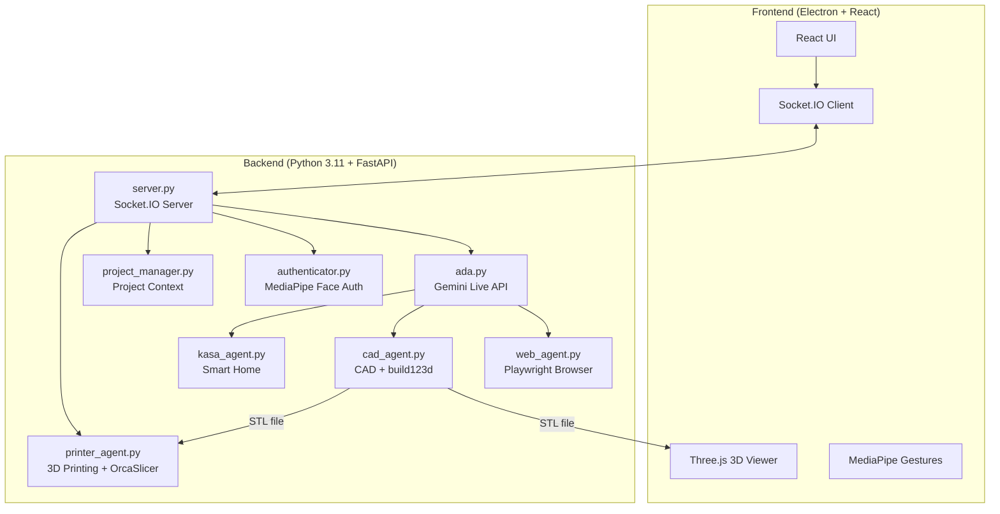

# SPARK — Immersive AI Workstation

## Stage 9 — Groq voice + explicitly requested visual questions + approved apps

Groq voice remains on `openai/gpt-oss-20b`, with Whisper transcription and
local Windows speech. To enable the *separate* experimental Groq vision path,
first verify that `qwen/qwen3.8-27b` is available **within your Groq free
account** and that your account cannot generate paid charges; do not enable
billing. Then set `SPARK_GROQ_VISION_ENABLED=1` in the runtime environment
and launch Groq mode as before. Vision is disabled by default.

In Groq mode, opening the camera starts **local preview only**. Choose
**SHARE WITH GROQ VISION** to allow a single newest 640x360 JPEG frame to be
cached *in memory on this PC* (up to one frame/sec). Nothing goes to Groq
when simply opening the camera or moving about. Say **"What do you see?"**
or **"Describe what you see"** (or type it) to explicitly authorize sending
**one fresh image** and that question to the documented Groq Qwen vision
model. The original voice assistant speaks and displays the answer. Frames
expire after 5 seconds and are cleared on revoke, camera stop, disconnect
or voice stop. The prompt/image are not placed in SPARK chat history or
saved files. Groq vision is not continuous real-time video or automatic
scene narration; it requires each explicit question and available free
provider quota. If quota/model access fails, SPARK does not purchase,
retry, or silently switch to another provider.

In **Groq voice mode**, say **"Open Notepad"**, **"Open Calculator"**, or
**"Open Paint"**. The strict local parser recognizes only these exact
requests. SPARK opens an interactive **AUTHORIZATION REQUIRED** panel,
bound to the active session owner; denying, closing, disconnecting or
waiting 30 seconds blocks the launch. Approval launches the fixed Windows
executable through `spark_desktop.launch_allowed_app`; no shell,
arguments, arbitrary files, URL navigation, unapproved PowerShell
commands or model-generated executable names are accepted.

This is implementation and CI-level qualification, not acceptance on
your particular Windows camera, speaker, Groq account or hardware.

## Camera → Gemini Live: separate, revocable consent

Turning on **Camera** opens only the local preview and hand tracking. **No video
frames are sent to AI by default.** When Gemini Live is connected, select
**SHARE WITH GEMINI** within the webcam overlay to explicitly enable a
bounded 640×360 JPEG stream (at most one frame/sec). The status badge becomes
**AI SHARING ON**. Select **STOP AI VIEW** to revoke consent at any moment.

The backend rejects frames unless they come from the active session-owning
window, an authenticated user when face authentication is enabled, a connected
Gemini Live session, and the explicit consent held for that session. Sharing
is dropped on camera stop, connection loss, Live restart and owner disconnect;
it is not saved to settings or disk. Invalid/oversize frames are rejected.
A late authorization acknowledgement is revoked when preview is no longer on.

**Groq voice cannot analyze camera frames in this release.** Its local webcam
preview remains local-only, and the overlay says so. The camera-sharing
control is disabled unless Gemini Live is connected. No paid fallback, new
model subscription, background camera recording or desktop permission is
introduced. This is *not* always-on scene narration: Gemini decides how to
interpret shared frames during active conversation. Device-level acceptance
still requires a Windows webcam and working Gemini Live session.


SPARK combines the **original ADA V2 engine** (MIT) with launchable, pinned, **original HOLO Gestures and Brain Map** experiences (also MIT), while retaining the upstream licences and attributions. The main interface is a premium React/Electron cockpit, not a static concept illustration.

## ARKUS-inspired Focus Mode + SPARK Resource Advisories

The SPARK cockpit has a **FOCUS** toolbar control with an offline
focus timer, inspired by the high-level user workflow in the
user-owned ARKUS `focus.py` implementation. Choose 5, 25 or 50
minutes (or a custom whole number up to 240); optionally name your
work, then Start, Pause, Resume, Add 5 minutes, or Reset. A wall-clock
deadline means the countdown remains accurate when a browser tab is
throttled. Closing the panel merely hides the timer; it stays mounted
in the main SPARK cockpit. Restarting SPARK clears the ephemeral
session. It does not create background processes, inspect foreground
apps, use the microphone/camera, or store attention/health scores.
**No app tracking is active, so no observed attention percentage or
distraction count is claimed.**

The existing **SYSTEMS** panel now offers lightweight advice using
its already collected, read-only Windows telemetry:
- RAM at or above 80%: recommend closing unused applications/tabs.
- Free system-drive space at or below 15 GB: recommend examining files
  before building, never deleting them.
- Battery at or below 25% while disconnected from AC: recommend
  connecting the charger.
- CPU at or above 90%: recommend reducing simultaneous heavy workloads.

Unknown or invalid readings produce no advice, not false alarms. All
advice is bounded local text; it never invokes agents, shell
commands, process termination or cloud AI. The new functionality
adds no paid integrations and leaves voice, REA evidence and Android
Health Connect paths unchanged.

This release provides **functional local timer and advisory components**,
not full ARKUS active-window monitoring, posture detection, or
autonomous action remediation. Automated state-machine tests and
production build are separate from Windows desktop acceptance.

## Windows Systems Vitals — source-independent integration

SPARK's **SYSTEMS** panel now shows CPU usage, RAM usage/available RAM,
free space on the Python runtime drive, battery percentage and AC power
status. These are **read-only** snapshots collected on demand from the
Windows `kernel32` public APIs (`GetSystemTimes`,
`GlobalMemoryStatusEx`, `GetSystemPowerStatus`) and Python's
`shutil.disk_usage`. The panel refreshes through SPARK's existing local
diagnostic Socket.IO event. The sampling runs off the audio event loop.
No background cloud calls, API credentials, REA execution, paid services,
new Python dependencies, or device control privileges are needed.

The command exposes **no drive paths, process names, PIDs, stored files
or accounts** to the UI. Unknown hardware readings show *Not available*,
not invented values. The copyable diagnostic report includes only
bounded numeric totals and a boolean AC-power state.

This is an **original, independently written implementation** of a common
desktop-health capability also offered by Brahma AI Evo. Brahma's
source-available license restricts copying/redistribution and commercial
reuse. Its code is **not copied or imported** into SPARK. The local
REA compact summaries are static counts and do not establish parity or
functional acceptance.

The automated unit tests cover valid/malformed telemetry and CPU time
deltas. Final acceptance of Windows hardware sensor readings still
requires running SPARK on your actual PC.

## REA AUDIT — local static evidence intake (opt-in)

SPARK now contains a **REA AUDIT** button that reads previously generated
REA JSON reports **from your own Windows PC** when clicked. This is the
first evidence-intake stage for the requested cross-repository feature
integration, **not** automatic cloning or execution of recovered code.

1. After updating and restarting SPARK, select **REA AUDIT** in its top bar.
2. Click **Scan existing REA reports**. The Electron main process reads only
   supported, size-limited JSON filenames in these two pre-existing folders:
   - `%USERPROFILE%\\work\\rea-evidence\\`
   - `%USERPROFILE%\\work\\arkus-rea-audit\\reports\\`
3. The panel displays each recognized report and the REA evidence identity,
   number of files, parsed-JavaScript counts, parse failures and static
   findings **where supplied by the actual file**.
4. Click **Copy inventory** and paste the resulting redacted summary into the
   SPARK integration review. It includes neither local filesystem paths
   nor untrusted report prose or source code. Review the full original
   audits privately and share only authorized, redacted evidence if
   feature-level analysis is required.

The port recognizes REA `normalized_result.statistics` compact summaries
and `ARKUS_REA_AUDIT.json`-style manifests. A *static finding* is a code
indicator, **not** proof that a feature exists or functions. In particular,
REA's JavaScript/Electron summaries do not validate O.L.L.I.E's Python,
motor/CAN or RealSense runtime. Full feature integration requires reading
relevant source, writing acceptance tests, and validating on Windows and
any specific hardware.

The user-controlled scan does **not** invoke REA, execute scripts, browse
the web, change permissions, upload private evidence, update dependencies,
or make Gemini/Groq API requests. Files are opened read-only, regular files
only, with an 8 MiB file limit, 16 MiB aggregate cap and at most 64 files.
Unknown JSON schemas are skipped. The API/Agent Manager remains on hold.
SPARK's existing voice, greetings, camera and Android activity features
are unaffected.

## ARKUS Android / Garmin fēnix 7 import — SPARK Companion

The existing user-owned ARKUS **Android Health Connect companion** has
been ported to SPARK, with Android package `com.spark.companion`, the
`SPARK Companion` label, original read-only Health Connect exercise,
steps and distance permissions, an explicit Copy Summary action, and an
independent Android debug APK build workflow.

SPARK's **PHONE / WATCH** cockpit button opens a manual seven-day
activity import panel. Install the Android APK from a successful
**Build SPARK Android Companion** GitHub Actions run, authorize access
in Android Health Connect, copy/share the summary on your phone,
transfer the text yourself and paste it into SPARK's panel. The activity
snapshot remains visible in that panel only, not persisted or sent to
Groq/Gemini.

For Garmin fēnix 7 data to appear, pair the watch with the official
Garmin Connect app, then enable Garmin Connect's **one-way Health Connect
sharing** on Android 14+ and grant SPARK Companion access. Data may
also come from non-Garmin sources; no Garmin-only attribution is made.
**This is not direct Bluetooth or Garmin account pairing**, not remote
Android control, and not automatic PC synchronization. ARKUS did not
contain those capabilities. See [android/README.md](android/README.md).

## Groq spoken replies and automatic opening greeting

When using `-AIProvider groq`, SPARK now uses a **Windows/Chromium
English speech voice** for audible replies. This avoids the Groq Orpheus
speech endpoint, which returned `Groq speech HTTP 400` on some
accounts even while Whisper transcription and chat worked. It does not
change your Groq chat model or Google Gemini Live/Charon profile.

As soon as Chromium reports its acoustic echo-cancelled audio graph
ready, the Groq session greets you exactly once: "Good day, sir. SPARK
is online and listening. How may I assist you?" This is generated
locally and consumes **no cloud speech, transcription or chat quota**.
For each Groq answer, the browser selects an installed English voice,
preferring British-English male voices when available. Because system
speech does not run through the WebAudio playback reference, SPARK
automatically gates microphone transmission during the utterance and
rearms afterward, respecting your manual mute status. If the OS voice
is missing or blocked, it reports a speaker/voice warning without
silently disabling the original Gemini voice profile.

No Ollama, local language model or paid subscription is added. Speech
quality depends on English voices installed in Windows. The
on-device Windows speaker and automatic greeting require real
hardware acceptance and cannot be validated by Linux CI alone.

## Systems Center: diagnostics, export and keyboard mute

SPARK's top bar now includes a clearly labelled **SYSTEMS** control. It
opens a large, readable status panel displaying the locally selected
provider, model, Live state, acoustic echo cancellation readiness, microphone
state, and backend uptime. Its Refresh action requests a bounded, read-only
snapshot from the **existing local Socket.IO backend**, not any external AI
service. Provider quota balances are not available through the panel; an
actual quota error cannot be cleared by a refresh. The safe report omits
credentials, local file paths, full exception messages and conversations.

Use **Copy report** to copy only the approved health fields for technical
support. **Save transcript (.md)** opens an explicit Windows save dialog;
nothing is written until you choose a destination. The export contains up to
200 recent messages and safe source URLs. **Review before sharing:** your
conversation itself may include personal or sensitive information. Neither
report nor transcript is uploaded to GitHub.

**Ctrl+Shift+M** toggles the existing mute action. It does not start another
recording process, use a wake word, activate a paid model or change voice
selection.

These features are separate from the paused API & Agent Manager and do not
modify Gemini, Groq, source routing, or the working Chromium AEC signal path.
Device acceptance is still checked on the user's own Windows PC.

## Alternative provider: Groq cloud hands-free voice — no Ollama

SPARK can now run a separate, explicitly selected cloud voice pipeline when
Gemini Live has reached its quota. **No Ollama, local LLM download, WSL,
Google key or paid subscription is required.** The Groq free plan has its
own limits for Whisper and text reasoning; speaking replies now uses
Windows' installed voice without any Orpheus requests. Quota errors
are reported safely with no retries or switch to billed models.

- Speech in: Chromium AEC capture at 16 kHz, bounded automatic VAD,
  Groq Whisper `whisper-large-v3-turbo`.
- Reasoning: Groq-hosted `openai/gpt-oss-20b`, short bounded exchanges.
  Groq retired `llama-3.1-8b-instant` on 16 August 2026 for free and developer-tier customers; the launcher rejects that obsolete model.
- Speech out: local Windows/Chromium English voice (`en-GB` preferred),
  gated against the existing Chromium mic to prevent self-feedback.
  The original Google Charon voice remains in Gemini mode. There is no
  extra TTS cloud quota in the normal Groq-mode path.
- Keyless read-only API routes: `wiki Bicycle` uses Wikimedia summary;
  `convert 12 USD to INR` uses Frankfurter's latest published FX rate.
  Returned source links appear in SPARK's citation panel.
- Other prompts use Groq chat without tools. This cloud mode does **not**
  execute arbitrary Windows commands, Google Search, smart-home actions
  or camera analysis. These require separately approved tool integrations.

Create a **Groq free-plan** API key using <https://console.groq.com/keys>
and put it only in your machine's `C:\\Users\\ASUS\\spark\\backend\\.env`
as `GROQ_API_KEY=<private key>`. Keep existing Gemini settings unchanged.
**Never commit, paste, or display the value of the key.**

After closing the old SPARK window, launch:

```powershell
cd "$HOME\\spark"
git pull --ff-only origin main
Remove-Item Env:\\GEMINI_API_KEY -ErrorAction SilentlyContinue
powershell.exe -NoProfile -ExecutionPolicy Bypass -File .\\start-spark.ps1 -AIProvider groq -GroqModel openai/gpt-oss-20b -AudioTransport browser_aec
```

Try `SPARK, say hello in a short sentence`; without clicking, follow up
with `SPARK, summarize the result`. Then say `wiki Bicycle` or type
`convert 12 USD to INR`. Initial Chromium microphone permission may be
required; speaking turns are detected by a simple energy-based VAD. A quiet
room and a working microphone will improve accuracy. Unlike Gemini Live,
Groq does **not** provide a single continuous native speech WebSocket in this
implementation: each detected utterance sends one cloud STT and chat
request followed by local speech output. It is not as low-latency as
Gemini Live, and Groq's transcription and chat quotas still apply.

For status:

```powershell
Invoke-RestMethod "http://127.0.0.1:8000/status" |
    Select-Object ai_provider,groq_configured,live_model,audio_transport,hands_free_ready,live_state |
    Format-List
```

Expected `ai_provider: groq`, `groq_configured: True`,
`audio_transport: browser_aec`, `hands_free_ready: True`,
`live_state: connected`. Here `connected` means the local Groq voice
engine is ready to accept utterances; provider credentials and usage
limits are verified only on the first remote request.

The default launcher remains `-AIProvider gemini`. To return to the
previously qualified Charon voice, simply restart with
`-AIProvider gemini -LiveProfile cinematic_tools`. No provider fallback
is automatic. Groq's model and Whisper transcription are quota-limited;
the default Windows voice does not call Orpheus. SPARK never activates paid billing. Only use a Groq
project without paid billing if you require strictly zero cost.

## Stage 7 — Live Google Search grounding (explicit opt-in)

The Windows-tested `cinematic_tools` profile remains unchanged. Stage 7
adds an **experimental** `cinematic_search` profile: the original Charon
British-style cinematic voice, existing approval-gated Calculator / Notepad /
Paint functions, and native Google Search grounding in the same Live
WebSocket (per Google's Gemini Live tool-combination specification).

**Cost / no-money boundary:** Search is **never activated automatically**.
Google's official Live model pricing states Search grounding is supported in
the free tier; a Google project with **paid-tier billing** may incur per-query
charges after its included allowance. SPARK cannot inspect the project's
billing status or impose a hard monetary cap on Google's server-side queries.
Use this mode **only when you have verified the API key's project is a
free-tier project with no paid billing**, or when you explicitly accept
the potential charges. These flags do not enable or modify billing.

To test the new feature, after closing the old SPARK process:

```powershell
cd "$HOME\\spark"
git pull --ff-only origin main
Remove-Item Env:\\GEMINI_API_KEY -ErrorAction SilentlyContinue
powershell.exe -NoProfile -ExecutionPolicy Bypass -File .\\start-spark.ps1 -LiveProfile cinematic_search -EnableGoogleSearch -AudioTransport browser_aec -LiveModel gemini-3.8-live
```

The required `-EnableGoogleSearch` launch flag is intentional. Without it,
the launcher exits safely; a direct backend session also refuses to assemble
a grounding config unless `SPARK_ENABLE_GOOGLE_SEARCH=1` was explicitly set.

Ask: **"SPARK, use Google Search to find today's latest aerospace news and
give me the sources."** The cockpit displays provider-supplied source cards
when Gemini returns `grounding_metadata`. Clicking a source opens it in
the default Windows web browser through restricted Electron IPC, never in
SPARK's privileged renderer. If no citations arrive, SPARK must not claim
it has verified them. Follow up with **"SPARK, open Calculator"** and
approve the normal popup; desktop actions remain restricted.

If Google rejects this experimental Live combination (including 1008),
do **not** repeatedly retry. Restart with `-LiveProfile cinematic_tools`
and omit `-EnableGoogleSearch` to restore the already-qualified voice tools.
The base `cinematic` mode stays unchanged. GitHub CI checks schema,
grounding source sanitization, and display wiring, not Google billing
eligibility or on-device search execution.

## Stage 6 — cinematic voice with narrowly permitted desktop tools (opt-in)

The verified default `-LiveProfile cinematic` stays unchanged and tool-free.
To trial voice-initiated actions **without sacrificing Chromium AEC**, use
the separate `cinematic_tools` profile:

```powershell
cd "$HOME\\spark"
git pull --ff-only origin main
Remove-Item Env:\\GEMINI_API_KEY -ErrorAction SilentlyContinue
powershell.exe -NoProfile -ExecutionPolicy Bypass -File .\\start-spark.ps1 -LiveProfile cinematic_tools -AudioTransport browser_aec -LiveModel gemini-3.8-live
```

The new Live session declares only two synchronous tools:

- **get_system_status:** returns SPARK service name, operating-system family,
  and local time; no external execution or account access.
- **launch_desktop_app:** opens only Calculator, Notepad or Paint using
  the existing shell-free Windows allowlist, **only after approval in the
  initiating SPARK window**. Denied or unanswered approvals (45 seconds)
  produce no action. A second client cannot approve a different window's
  request.

Try `SPARK, what time is it on this computer?` and then `SPARK, open
Calculator.` Approve the application in the popup before expecting it to
launch. Check `/status`: `live_profile` should be `cinematic_tools`,
`audio_transport` should be `browser_aec`, and only the local Windows
acceptance test can establish that the selected Gemini Live model accepts
these function declarations.

**If the experimental tool session fails to connect or returns 1008, do
not repeatedly retry**: restart with `-LiveProfile cinematic` to preserve
your previously qualified hands-free voice. Do not select the legacy `full`
profile merely to enable desktop actions. It advertises many unqualified
tools and may fail independently. This opt-in profile does **not yet**
provide live web search, camera understanding or general computer control;
these will be isolated in subsequent stages. No paid model or account
changes are required.

## True hands-free Gemini Live voice — Chromium acoustic echo cancellation

The default Windows launcher now uses `-AudioTransport browser_aec`. This is
a distinct, single audio engine for both **microphone capture and Gemini
speech playback**. Chromium's `getUserMedia` microphone stream requests
`echoCancellation: true`, noise suppression and automatic gain control,
and SPARK checks the actual active mic track setting before forwarding **any**
microphone PCM. A lightweight AudioWorklet produces 16-kHz mono PCM in
100-ms binary chunks over the local Socket.IO connection. Gemini's 24-kHz
PCM is rendered by the **same Chromium AudioContext**, providing a browser
speaker reference to the echo canceller.

Unlike the previous one-turn workaround, browser AEC mode **does not latch
the microphone between replies**: continuous follow-up questions and normal
server-side Live VAD work without clicking a mic button each time. SPARK
still preserves its existing cinematic Charon voice and explicit microphone
mute/power controls. A one-time Windows/Electron microphone permission grant
may be needed on first launch. Browser audio begins only after Live connects
and Chromium confirms a working AEC-enabled microphone and output context.

To activate on Windows:

```powershell
cd "$HOME\\spark"
git pull --ff-only origin main
Remove-Item Env:\\GEMINI_API_KEY -ErrorAction SilentlyContinue
powershell.exe -NoProfile -ExecutionPolicy Bypass -File .\\start-spark.ps1 -LiveProfile cinematic -LiveModel gemini-3.8-live -AudioTransport browser_aec
```

The safe local `/status` endpoint reports `audio_transport: browser_aec`,
`hands_free_ready: true`, `live_state: connected` after both
provider and Chromium audio paths are prepared. Keep Windows Sound input
set to your physical microphone, not a recording loopback such as Stereo Mix;
if an unsupported sound device reports AEC unavailable, SPARK **fails closed**
rather than silently switching to raw PyAudio capture. Try another Windows
microphone or the default output device. If needed, the older one-turn mode
is explicitly recoverable with `-AudioTransport native`; it is not
automatically activated.

Echo cancellation effectiveness depends on the Windows microphone, speakers,
audio driver and room acoustics and must be tested on the actual PC. Start
with a low volume and a short back-and-forth conversation. Shut down SPARK
if it echoes, and inspect the `hands_free_ready` field and audio devices.
No new AI service, key or paid subscription is required.

## Cinematic microphone safety — one activation, one answer

**October 2026 feedback-loop containment:** the cinematic profile uses an
additional microphone latch. As soon as the first Gemini audio packet arrives,
SPARK blocks upstream microphone PCM and notifies the Electron interface that
the microphone is muted. It **does not automatically reopen** after the
750-ms speaker tail. Wait until the reply finishes, then click the existing
microphone button to ask the next question. Clicking while SPARK is speaking
is rejected; the interface stays muted.

This is a deliberate temporary safety tradeoff, not full acoustic echo
cancellation. Natural hands-free turn taking and voice interruption are not
yet certified; they require a proper capture echo-cancellation path (AEC)
and a separate local acceptance test. Keep headset volume low when testing.
If repeated model speech continues even with the mic latched, stop the session
and investigate model output or duplicate session generation; do not assume
that only hardware echo is involved.

The earlier `1008 Requested entity was not found` WebSocket failure seen in
one prior launch is separate from the reported acoustic self-conversation and
must not be misclassified as a 429 quota failure.

## Cinematic SPARK voice — default launch

SPARK now has an **original cinematic AI command-center voice**, styled for
calm, precise British English delivery, understated dry wit, and concise
operational responses. The official Gemini Live prebuilt `Charon` voice
(informative timbre) is chosen for the cinematic profile; it is **not a
replica of any actor or film character**, and model-dependent accent and
timbre fidelity must be evaluated by ear on the local device.

The ordinary Windows launcher selects this cinematic voice by default:

```powershell
cd "$HOME\\spark"
Remove-Item Env:\\GEMINI_API_KEY -ErrorAction SilentlyContinue
powershell.exe -NoProfile -ExecutionPolicy Bypass -File .\\start-spark.ps1
```

The three allowed Live profiles are:

- `-LiveProfile cinematic` (default): `gemini-3.8-live`, `Charon` voice,
  bespoke mission-control persona; no external tools or transcription.
- `-LiveProfile voice`: the previously qualified bare minimum Gemini
  handshake, **no custom voice/prompt**. Select this if the cinematic
  configuration triggers a provider rejection.
- `-LiveProfile full`: all existing tools/transcription and the existing
  Kore voice; this complex profile previously returned HTTP 429 and requires
  separate live acceptance before operational use.

Cinematic and voice modes retain the microphone half-duplex echo suppression;
do not expect hands-free barge-in while SPARK is speaking. The profile option
changes **only how the Live session is configured**, not the Gemini API key,
billing authorization, operating-system permissions or model quotas. Observe
the `live_profile` and `live_state` fields from local `/status`.
If provider setup fails, return to `-LiveProfile voice` and report the
redacted error rather than repeatedly restarting.

## Audio feedback safety (October 2026)

SPARK's native PyAudio capture does not implement hardware acoustic echo
cancellation. On laptop speakers, a microphone (or Windows "Stereo Mix" /
"Listen to this device" routing) can return the assistant's voice back
to Gemini, causing endless repeated conversations. The live voice engine
now enforces **half-duplex** transmission by default, in both full and
voice-only profiles: it stops forwarding microphone PCM as soon as model
audio arrives, keeps listening locally but discards captured microphone
samples during speaker playback, and resumes upstream microphone audio
after the playback queue is drained and a 750-ms tail in basic voice mode. Cinematic mode requires manual reactivation before further microphone PCM is transmitted. It also discards
microphone chunks that were queued immediately before assistant audio.
This does not modify the key, model, or quota.

Limitation: you **cannot interrupt SPARK by voice while it is speaking**.
Use the microphone mute/power controls or stop the launcher to interrupt.
Headphones are recommended; in Windows Sound > Input, select the actual
microphone rather than "Stereo Mix" or "What U Hear", and turn off
"Listen to this device" when not intentionally needed. Start with laptop
speakers at low volume and hand-tracking/camera disabled; run a single
short spoken exchange and check there is no repeated self-response.
CI verifies the gate logic, not real Windows echo cancellation hardware.

## Live voice isolation profile (after a successful minimal handshake)

If `scripts/spark_live_handshake.py --attempt-once` reports `connected`,
but the full desktop session fails with HTTP 429, test the same known-good
minimal configuration using SPARK's **real microphone/speaker stream**.
This is a deliberate diagnostic: voice mode temporarily omits Google Search,
tool declarations, custom voice, and transcription. The original full
configuration remains available by explicit selection only.

```powershell
# First close every prior SPARK/Electron process and confirm port 8000 is free.
cd "$HOME\\spark"
Remove-Item Env:\\GEMINI_API_KEY -ErrorAction SilentlyContinue
powershell.exe -NoProfile -ExecutionPolicy Bypass -File .\\start-spark.ps1 -LiveModel gemini-3.8-live -LiveProfile voice
```

In another shell, inspect `http://127.0.0.1:8000/status`, including
`live_profile`, `live_state`, `live_message` and `live_error_code`.
Once connected, enable the microphone and confirm bidirectional speech.
Voice-only mode cannot use SPARK's model-initiated desktop controls,
search or other tools. After the cause has been narrowed down, restart
with `-LiveProfile full` to restore all features; **full mode
remains unqualified until its own live acceptance passes**.
A single successful minimal handshake does not guarantee audio streaming
and does not rule out temporary provider rate limits.

## Diagnose Live error 429 without SPARK tools (one explicit request)

A key that lists a Live model does not prove that the project has a Live-session
allocation. A newly created Google Cloud project can also return 429, so avoid
assuming either an app syntax error or exhausted daily usage without isolating
the provider connection.

Close SPARK first, then check that no old process holds port 8000. From a new
PowerShell window, run an **explicit, one-shot** minimal handshake:

```powershell
cd "$HOME\\spark"
Remove-Item Env:\\GEMINI_API_KEY -ErrorAction SilentlyContinue
& ".\\.venv\\Scripts\\python.exe" ".\\scripts\\spark_live_handshake.py" --attempt-once
```

The script takes the separate key from `backend/.env`, uses the official
`google-genai` SDK with API `v1beta`, attempts **one** Live WebSocket
setup with only `response_modalities=["AUDIO"]`, and closes immediately.
It has no mic, camera, search, tools, transcription, prompt or retry loop.
The connection itself may still count against project limits; never run it
repeatedly when it returns 429.

Interpretation: `connected` means the provider accepts the minimal
connection, so investigate SPARK's additional Live config (tools, voice,
transcription) next. `quota_or_rate_limit` from this isolated script
means SPARK's complex session setup is not required to reproduce the
provider rejection. `invalid_request` means SDK/endpoint/request
compatibility deserves investigation. No result authorizes paid billing.

## SPARK CORE — Gemini Live voice (October 2026)

The desktop UI, Socket.IO, and microphone unmute indicator **do not** prove a Gemini session is live. SPARK Core now uses Google's supported `gemini-3.8-live` model, sends 16-kHz PCM through `send_realtime_input`, and shows distinct **connecting**, **connected**, **microphone error**, **setup required**, or **Gemini error** states. On startup, the backend reads a private key from `backend/.env` or the `GEMINI_API_KEY` environment variable. It will not print or expose the key through the UI.

**Existing ARKUS Google key — optional only (SPARK normally has a separate key):**

```powershell
cd "$HOME\\spark"
git pull --ff-only
powershell -ExecutionPolicy Bypass -File .\\start-spark.ps1 -UseArkusGeminiKey
```

This command reads `%APPDATA%\\arkus\\config.json` locally and passes `api_key` only to SPARK's Python process environment. It does not copy the key to Git, save a new credential file, or change Google AI Studio billing. Alternately, set `GEMINI_API_KEY` in your shell or supply your own private `backend/.env`. ARKUS's **Flash** model and any old **Flash grounding 429 error** are independent of SPARK's Gemini **Live** model. Gemini Live still has rate limits and requires actual Windows microphone/speaker permissions.

The SPARK assistant auto-establishes a Gemini Live session after local backend and user authorization; the microphone starts **muted** and responds only after you press the microphone button. Audio responses require a working Windows speaker. Your first test should be to unmute and say, "SPARK, can you hear me?"; typed questions should now use the SDK's `send_client_content` method and receive a clear error when there is no session.

**Dedicated SPARK project and explicit model selection (free-tier only):**
Save SPARK's API key privately in `backend/.env` as `GEMINI_API_KEY=...`.
Do not add `-UseArkusGeminiKey` when using a separate project.
The launcher defaults to `gemini-3.8-live`. If that model has no available Live-session capacity in the selected Google AI Studio project, inspect that project's **own rate-limit row** before optionally trying the supported `gemini-3.1-flash-live-preview` model:

```powershell
cd "$HOME\\spark"
Remove-Item Env:\\GEMINI_API_KEY -ErrorAction SilentlyContinue
powershell.exe -NoProfile -ExecutionPolicy Bypass -File .\\start-spark.ps1 -LiveModel gemini-3.1-flash-live-preview
```

Model selection is **explicit**, not automatic; it does not bypass project quotas, provision a new key, or enable billing. The listed model may still return HTTP 429 if your project has no available allowance for it. Google model-listing success is not proof of Live-session quota.

Developer notes: Live model names are restricted to documented compatible options, and unknown/retired model names fall back to `gemini-3.8-live` inside the Python runtime. Real provider, hardware and account acceptance remains separate from CI tests.

## Windows backend startup repair (October 2026)

Use `start-spark.ps1` to create an isolated `.venv` with a compatible Python interpreter, test its essential module imports, and install the narrower `requirements-runtime.txt` set if needed. **Python 3.12 is recommended** for Windows audio and MediaPipe wheels. Python 3.14 is not yet qualified for this ADA-derived backend. When only Python 3.14 is installed, the launcher prints an explicit Python 3.12 requirement rather than repeatedly failing on `ModuleNotFoundError: socketio`. Do not uninstall or change the Python 3.14 interpreter used by ARKUS.

```powershell
cd "$HOME\\spark"
git pull
powershell -ExecutionPolicy Bypass -File .\\start-spark.ps1
```

If Python 3.12 is missing, install it alongside 3.14 and rerun the same command. The new venv remains isolated inside `spark/.venv` (ignored by Git). On shutdown, Electron terminating normally now reports success rather than `vite exited with code 1`; dead Python process IDs are not sent to `taskkill`.

**Scope:** this runtime set supports core ADA imports and voice/camera/smart-home packages but does not install the optional `build123d` CAD kernel or download Playwright browsers or 3D printer slicers. Those integrations require separate installation and physical acceptance. Gemini requires `GEMINI_API_KEY` set privately in `backend/.env` before Live activation; absence of a key no longer blocks GUI startup. A successful offline preflight does not demonstrate a functioning real Gemini call, microphone, printer or camera.

NPM security audit warnings remain separate from this startup fix; do not run `npm audit fix --force` indiscriminately on ADA's older Electron/Vite dependency graph.

## SPARK setup — Windows 11

**One-command launch from an existing checkout:**

```powershell
powershell -ExecutionPolicy Bypass -File .\\start-spark.ps1
```

For manual setup or troubleshooting:

```powershell
# In your existing SPARK repository checkout:
git pull
npm ci
npm run setup:experiences
npm run dev
```

Requires Git, Node.js 22+, and a Python interpreter on PATH (or use `SPARK_PYTHON`). The original ADA V2 backend separately requires the open-source packages in `requirements.txt` and its own local configuration. If those Python packages are missing, the SPARK UI will still open and its HOLO/Brain experiences can be launched; core AI/CAD/printing functions will remain disconnected until their dependencies are installed and configured. Installing all upstream Python dependencies can require considerable disk space and compatible Python wheels; the launch script does **not** silently install them. To launch both original experiences, click **EXPERIENCE DECK** in the SPARK top toolbar, then **HOLO DECK** or **NEURAL ATLAS**. The applications launch on `127.0.0.1:4890` and `127.0.0.1:4710` respectively in separate, sandboxed Electron windows. HOLO uses its self-hosted MediaPipe model, Three.js and original GLB scans; Brain Map uses its original Markdown `[[wikilinks]]`, physics layout, search, and replay. Both launch **only when the user clicks**; no camera or microphone activates automatically.

By default the original example notes bundled with HOLO are used, ensuring both experiences have visible content. For Brain Map, set `SPARK_NOTES_DIR` to an **existing local Markdown folder** before launching SPARK; for HOLO, edit the upstream `vendor/holo-gestures/holo.json` `folder` field on your own PC. These two independent apps do not yet synchronize ADA's project memory.

To use a separately installed Python interpreter, set `SPARK_PYTHON` before launch. Neither checkout includes a Gemini API credential; continue keeping secrets in private local configuration. Existing CAD/printer/Kasa tools remain ADA V2 functionality and require actual hardware acceptance. Run `npm test` for the local experience path tests and `npm run build` for Vite production output. An installer EXE is **not yet built** by this repository.

### Third-party rights and boundaries

The two experiences are Git submodules pinned to reviewed Git commit IDs, not copied snapshots with altered ownership. `npm run setup:experiences` downloads their original repos. The existing ADA V2 implementation is MIT-licensed. See [third-party notices](THIRD_PARTY_NOTICES.md). Brahma AI Evo prohibits code mirroring or redistribution (including private GitHub hosting), so it is **not copied**. O.L.L.I.E lacks a redistribution licence; its source is **not copied**. SPARK does not grant blanket remote OS, network, account or hardware access merely because an assistant requests it.

---

## Original ADA V2 engine documentation (retained for attribution)


> **A.D.A** = **A**dvanced **D**esign **A**ssistant

ADA V2 is a sophisticated AI assistant designed for multimodal interaction. It combines Google's Gemini 2.5 Native Audio with computer vision, gesture control, and 3D CAD generation in a Electron desktop application.

---

## 🌟 Capabilities at a Glance

| Feature | Description | Technology |
|---------|-------------|------------|
| **🗣️ Low-Latency Voice** | Real-time conversation with interrupt handling | Gemini 2.5 Native Audio |
| **🧊 Parametric CAD** | Editable 3D model generation from voice prompts | `build123d` → STL |
| **🖨️ 3D Printing** | Slicing and wireless print job submission | OrcaSlicer + Moonraker/OctoPrint |
| **🖐️ Minority Report UI** | Gesture-controlled window manipulation | MediaPipe Hand Tracking |
| **👁️ Face Authentication** | Secure local biometric login | MediaPipe Face Landmarker |
| **🌐 Web Agent** | Autonomous browser automation | Playwright + Chromium |
| **🏠 Smart Home** | Voice control for TP-Link Kasa devices | `python-kasa` |
| **📁 Project Memory** | Persistent context across sessions | File-based JSON storage |

### 🖐️ Gesture Control Details

ADA's "Minority Report" interface uses your webcam to detect hand gestures:

| Gesture | Action |
|---------|--------|
| 🤏 **Pinch** | Confirm action / click |
| ✋ **Open Palm** | Release the window |
| ✊ **Close Fist** | "Select" and grab a UI window to drag it |

> **Tip**: Enable the video feed window to see the hand tracking overlay.

---

## 🏗️ Architecture Overview



---

## ⚡ TL;DR Quick Start (Experienced Developers)

<details>
<summary>Click to expand quick setup commands</summary>

```bash
# 1. Clone and enter
git clone https://github.com/nazirlouis/ada_v2.git && cd ada_v2

# 2. Create Python environment (Python 3.11)
conda create -n ada_v2 python=3.11 -y && conda activate ada_v2
brew install portaudio  # macOS only (for PyAudio)
pip install -r requirements.txt
playwright install chromium

# 3. Setup frontend
npm install

# 4. Create .env file
echo "GEMINI_API_KEY=your_key_here" > .env

# 5. Run!
conda activate ada_v2 && npm run dev
```

</details>

---

## 🛠️ Installation Requirements

### 🆕 Absolute Beginner Setup (Start Here)
If you have never coded before, follow these steps first!

**Step 1: Install Visual Studio Code (The Editor)**
- Download and install [VS Code](https://code.visualstudio.com/). This is where you will write code and run commands.

**Step 2: Install Anaconda (The Manager)**
- Download [Miniconda](https://docs.conda.io/en/latest/miniconda.html) (a lightweight version of Anaconda).
- This tool allows us to create isolated "playgrounds" (environments) for our code so different projects don't break each other.
- **Windows Users**: During install, check "Add Anaconda to my PATH environment variable" (even if it says not recommended, it makes things easier for beginners).

**Step 3: Install Git (The Downloader)**
- **Windows**: Download [Git for Windows](https://git-scm.com/download/win).
- **Mac**: Open the "Terminal" app (Cmd+Space, type Terminal) and type `git`. If not installed, it will ask to install developer tools—say yes.

**Step 4: Get the Code**
1. Open your terminal (or Command Prompt on Windows).
2. Type this command and hit Enter:
   ```bash
   git clone https://github.com/nazirlouis/ada_v2.git
   ```
3. This creates a folder named `ada_v2`.

**Step 5: Open in VS Code**
1. Open VS Code.
2. Go to **File > Open Folder**.
3. Select the `ada_v2` folder you just downloaded.
4. Open the internal terminal: Press `Ctrl + ~` (tilde) or go to **Terminal > New Terminal**.

---

### ⚠️ Technical Prerequisites
Once you have the basics above, continue here.

### 1. System Dependencies

**MacOS:**
```bash
# Audio Input/Output support (PyAudio)
brew install portaudio
```

**Windows:**
- No additional system dependencies required!

### 2. Python Environment
Create a single Python 3.11 environment:

```bash
conda create -n ada_v2 python=3.11
conda activate ada_v2

# Install all dependencies
pip install -r requirements.txt

# Install Playwright browsers
playwright install chromium
```

### 3. Frontend Setup
Requires **Node.js 18+** and **npm**. Download from [nodejs.org](https://nodejs.org/) if not installed.

```bash
# Verify Node is installed
node --version  # Should show v18.x or higher

# Install frontend dependencies
npm install
```

### 4. 🔐 Face Authentication Setup
To use the secure voice features, ADA needs to know what you look like.

1. Take a clear photo of your face (or use an existing one).
2. Rename the file to `reference.jpg`.
3. Drag and drop this file into the `ada_v2/backend` folder.
4. (Optional) You can toggle this feature on/off in `settings.json` by changing `"face_auth_enabled": true/false`.

---

## ⚙️ Configuration (`settings.json`)

The system creates a `settings.json` file on first run. You can modify this to change behavior:

| Key | Type | Description |
| :--- | :--- | :--- |
| `face_auth_enabled` | `bool` | If `true`, blocks all AI interaction until your face is recognized via the camera. |
| `tool_permissions` | `obj` | Controls manual approval for specific tools. |
| `tool_permissions.generate_cad` | `bool` | If `true`, requires you to click "Confirm" on the UI before generating CAD. |
| `tool_permissions.run_web_agent` | `bool` | If `true`, requires confirmation before opening the browser agent. |
| `tool_permissions.write_file` | `bool` | **Critical**: Requires confirmation before the AI writes code/files to disk. |

---

### 5. 🖨️ 3D Printer Setup
ADA V2 can slice STL files and send them directly to your 3D printer.

**Supported Hardware:**
- **Klipper/Moonraker** (Creality K1, Voron, etc.)
- **OctoPrint** instances
- **PrusaLink** (Experimental)

**Step 1: Install Slicer**
ADA uses **OrcaSlicer** (recommended) or PrusaSlicer to generate G-code.
1. Download and install [OrcaSlicer](https://github.com/SoftFever/OrcaSlicer).
2. Run it once to ensure profiles are created.
3. ADA automatically detects the installation path.

**Step 2: Connect Printer**
1. Ensure your printer and computer are on the **same Wi-Fi network**.
2. Open the **Printer Window** in ADA (Cube icon).
3. ADA automatically scans for printers using mDNS.
4. **Manual Connection**: If your printer isn't found, use the "Add Printer" button and enter the IP address (e.g., `192.168.1.50`).

---

### 6. 🔑 Gemini API Key Setup
ADA uses Google's Gemini API for voice and intelligence. You need a free API key.

1. Go to [Google AI Studio](https://aistudio.google.com/app/apikey).
2. Sign in with your Google account.
3. Click **"Create API Key"** and copy the generated key.
4. Create a file named `.env` in the `ada_v2` folder (same level as `README.md`).
5. Add this line to the file:
   ```
   GEMINI_API_KEY=your_api_key_here
   ```
6. Replace `your_api_key_here` with the key you copied.

> **Note**: Keep this key private! Never commit your `.env` file to Git.

---

## 🚀 Running ADA V2

You have two options to run the app. Ensure your `ada_v2` environment is active!

### Option 1: The "Easy" Way (Single Terminal)
The app is smart enough to start the backend for you.
1. Open your terminal in the `ada_v2` folder.
2. Activate your environment: `conda activate ada_v2`
3. Run:
   ```bash
   npm run dev
   ```
4. The backend will start automatically in the background.

### Option 2: The "Developer" Way (Two Terminals)
Use this if you want to see the Python logs (recommended for debugging).

**Terminal 1 (Backend):**
```bash
conda activate ada_v2
python backend/server.py
```

**Terminal 2 (Frontend):**
```bash
# Environment doesn't matter here, but keep it simple
npm run dev
```

---

## ✅ First Flight Checklist (Things to Test)

1. **Voice Check**: Say "Hello Ada". She should respond.
2. **Vision Check**: Look at the camera. If Face Auth is on, the lock screen should unlock.
3. **CAD Check**: Open the CAD window and say "Create a cube". Watch the logs.
4. **Web Check**: Open the Browser window and say "Go to Google".
5. **Smart Home**: If you have Kasa devices, say "Turn on the lights".

---

## ▶️ Commands & Tools Reference

### 🗣️ Voice Commands
- "Switch project to [Name]"
- "Create a new project called [Name]"
- "Turn on the [Room] light"
- "Make the light [Color]"
- "Pause audio" / "Stop audio"

### 🧊 3D CAD
- **Prompt**: "Create a 3D model of a hex bolt."
- **Iterate**: "Make the head thinner." (Requires previous context)
- **Files**: Saves to `projects/[ProjectName]/output.stl`.

### 🌐 Web Agent
- **Prompt**: "Go to Amazon and find a USB-C cable under $10."
- **Note**: The agent will auto-scroll, click, and type. Do not interfere with the browser window while it runs.

### 🖨️ Printing & Slicing
- **Auto-Discovery**: ADA automatically finds printers on your network.
- **Slicing**: Click "Slice & Print" on any generated 3D model.
- **Profiles**: ADA intelligently selects the correct OrcaSlicer profile based on your printer's name (e.g., "Creality K1").

---

## ❓ Troubleshooting FAQ

### Camera not working / Permission denied (Mac)
**Symptoms**: Error about camera access, or video feed shows black.

**Solution**:
1. Go to **System Preferences > Privacy & Security > Camera**.
2. Ensure your terminal app (e.g., Terminal, iTerm, VS Code) has camera access enabled.
3. Restart the app after granting permission.

---

### `GEMINI_API_KEY` not found / Authentication Error
**Symptoms**: Backend crashes on startup with "API key not found".

**Solution**:
1. Make sure your `.env` file is in the root `ada_v2` folder (not inside `backend/`).
2. Verify the format is exactly: `GEMINI_API_KEY=your_key` (no quotes, no spaces).
3. Restart the backend after editing the file.

---

### WebSocket connection errors (1011)
**Symptoms**: `websockets.exceptions.ConnectionClosedError: 1011 (internal error)`.

**Solution**:
This is a server-side issue from the Gemini API. Simply reconnect by clicking the connect button or saying "Hello Ada" again. If it persists, check your internet connection or try again later.

---

## 📸 What It Looks Like

*Coming soon! Screenshots and demo videos will be added here.*

---

## 📂 Project Structure

```
ada_v2/
├── backend/                    # Python server & AI logic
│   ├── ada.py                  # Gemini Live API integration
│   ├── server.py               # FastAPI + Socket.IO server
│   ├── cad_agent.py            # CAD generation orchestrator
│   ├── printer_agent.py        # 3D printer discovery & slicing
│   ├── web_agent.py            # Playwright browser automation
│   ├── kasa_agent.py           # TP-Link smart home control
│   ├── authenticator.py        # MediaPipe face auth logic
│   ├── project_manager.py      # Project context management
│   ├── tools.py                # Tool definitions for Gemini
│   └── reference.jpg           # Your face photo (add this!)
├── src/                        # React frontend
│   ├── App.jsx                 # Main application component
│   ├── components/             # UI components (11 files)
│   └── index.css               # Global styles
├── electron/                   # Electron main process
│   └── main.js                 # Window & IPC setup
├── projects/                   # User project data (auto-created)
├── .env                        # API keys (create this!)
├── requirements.txt            # Python dependencies
├── package.json                # Node.js dependencies
└── README.md                   # You are here!
```

---

## ⚠️ Known Limitations

| Limitation | Details |
|------------|---------|
| **macOS & Windows** | Tested on macOS 14+ and Windows 10/11. Linux is untested. |
| **Camera Required** | Face auth and gesture control need a working webcam. |
| **Gemini API Quota** | Free tier has rate limits; heavy CAD iteration may hit limits. |
| **Network Dependency** | Requires internet for Gemini API (no offline mode). |
| **Single User** | Face auth recognizes one person (the `reference.jpg`). |

---

## 🤝 Contributing

Contributions are welcome! Here's how:

1. **Fork** the repository.
2. **Create a branch**: `git checkout -b feature/amazing-feature`
3. **Commit** your changes: `git commit -m 'Add amazing feature'`
4. **Push** to the branch: `git push origin feature/amazing-feature`
5. **Open a Pull Request** with a clear description.

### Development Tips

- Run the backend separately (`python backend/server.py`) to see Python logs.
- Use `npm run dev` without Electron during frontend development (faster reload).
- The `projects/` folder contains user data—don't commit it to Git.

---

## 🔒 Security Considerations

| Aspect | Implementation |
|--------|----------------|
| **API Keys** | Stored in `.env`, never committed to Git. |
| **Face Data** | Processed locally, never uploaded. |
| **Tool Confirmations** | Write/CAD/Web actions can require user approval. |
| **No Cloud Storage** | All project data stays on your machine. |

> [!WARNING]
> Never share your `.env` file or `reference.jpg`. These contain sensitive credentials and biometric data.

---

## 🙏 Acknowledgments

- **[Google Gemini](https://deepmind.google/technologies/gemini/)** — Native Audio API for real-time voice
- **[build123d](https://github.com/gumyr/build123d)** — Modern parametric CAD library
- **[MediaPipe](https://developers.google.com/mediapipe)** — Hand tracking, gesture recognition, and face authentication
- **[Playwright](https://playwright.dev/)** — Reliable browser automation

---

## 📄 License

This project is licensed under the **MIT License** — see the [LICENSE](LICENSE) file for details.

---

<p align="center">
  <strong>Built with 🤖 by Nazir Louis</strong><br>
  <em>Bridging AI, CAD, and Vision in a Single Interface</em>
</p>
