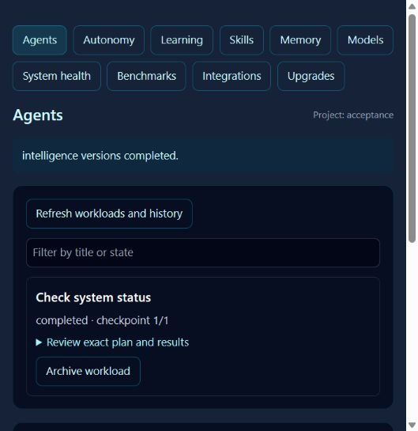

# Intelligence verification and handover

Scope: native Windows, Python 3.11.9, Spark's existing Vite/Electron frontend.
The capability matrix is machine readable in
[the manifest](openjarvis-integration-manifest.json). Operational commands and
recovery procedures are in [operations](intelligence-operations.md).

## Existing and new behavior

Before this integration Spark already had voice, camera consent, authentication,
CAD, printer, browser sessions, ARKUS document search and declarative calculation
skills. Those paths remain in place. Existing local printer, settings and camera
capability changes are excluded from these commits.

New behavior includes persistent bounded agents, checkpoints, explicit resume,
archiving, optional scheduling, learning candidate evaluation and rollback,
instructional skills, TTL memory and RRF retrieval, task-model routing,
MCP read grants and audit, diagnostics, benchmark exports, and staged source
repair. The ten console pages call these services; model answers are explicitly
unverified. Research optimizers and unconfigured external adapters are not
presented as working connections.

## Evidence boundaries

The regression suite exercises real SQLite storage, native processes, HTTP and
MCP fixtures, office document round trips, source backup/rollback, session and
face-auth gates, exact approval hashes, project isolation, cloud consent and
transport cleanup. Separate processes prove checkpoint persistence, once-only
scheduling and interrupted-state recovery after abrupt process exit. A `-S`
subprocess proves local status and search work without optional site packages.

Learning comparisons use a controlled model fixture for reproducible assertions;
local HTTP model protocol tests exercise actual request/response transport.
No live model quality improvement, fine tuning, energy savings, or autonomous
business outcome is claimed. Actual cached REA discovery returned 207 tool
schemas; invocation and policy rejection are exercised against a local MCP
counter fixture. REA tools are callable through the bounded host read allowlist,
not automatically granted every discovered capability. A separate direct REA
cockpit permits a human-selected call after displaying its arguments and a
confirmation that it may inspect or modify local targets.

A real staged source validation used unchanged `spark_cinematic_tools.py`,
passed the fixed Python regression runner and left production source unchanged.
Activation was not attempted. Staged tests are subprocess tests, not an OS
sandbox. Potentially malicious Python requires an external sandbox before
execution; source generation alone does not activate or test code.

The browser acceptance host uses the actual production workspace handler with
temporary storage and a fixture-only origin. It does not acquire microphones,
accounts or hardware. Agent create/review/approve/execute completed a real
Windows status step. Browser evidence does not qualify live voice, camera or
hardware operation. All ten navigation entries also receive an offline server-render check. All ten
page views were inspected in the live browser; memory save/retrieve, health,
model discovery, integration listing, benchmark evidence and version inspection
returned real service responses. Provider-dependent operations retain fixture
verification only.

## Windows and performance

All reported local execution uses PowerShell and native Windows processes;
no WSL, Docker or heavyweight research installation was required.
[The measured resource report](evidence/intelligence-performance.json) records
five actual local status jobs, process CPU time, traced Python allocations,
temporary storage and host vitals. This is a service-slice benchmark, not full
Electron RSS or an inference benchmark. One synthetic labeled retrieval query
is a fixture check, not a general quality score. Energy, cost and TTFT remain
null because no measurement source is available.

The host had approximately 7.7 GiB physical RAM with about 91% occupied.
Concurrency defaults to one (host maximum two), requests and result sizes are
bounded, monitoring and scheduling are optional, and models unload after use.
Heavy imports remain lazy. Real embedding/FAISS/model qualification is deferred
until local dependencies, a licensed model and adequate memory are available.

## Not run and remaining work

Five older live suites are excluded: authenticator, Kasa, printer, CAD and web
agent. They require camera assets, devices, or live provider calls; some change
real hardware. The existing opt-in Chromium session case stays skipped.
Voice and hardware are preserved by regression checks but still need explicit
human acceptance on configured devices. No remote business credentials were
supplied; nine adapters stay unconnected. VAOS and VYNDI OS require their actual
governed contracts rather than an invented generic endpoint. No paid service,
model download, deployment or merge was performed.

The baseline was 170 passing Python tests and one skip. The first JS baseline
had one Brain Map process timeout under host pressure; its isolated rerun passed.
An existing typed Google SDK configuration assertion was corrected to accept
the SDK's typed object while still asserting AUDIO. Initial missing pytest
dependencies were installed from the lightweight test group. Final counts and
revisions are recorded below after the final run.

## Final local results

Verified source revision: `250a88ad2781e876219bb6435d85a29b7b8e8572`.
Documentation/evidence commits follow that source revision.

| Check | Result |
|---|---|
| Offline pytest suite | 256 passed, 0 failed, 1 skipped; 147 subtests passed; 60.66 seconds |
| JavaScript tests, concurrency one | 88 passed, 0 failed, 0 skipped; 6.04 seconds |
| Production Vite build | Passed; 13.55 seconds; 2,399 modules |
| Intelligence lazy chunk | 25.39 kB minified / 6.87 kB gzip |
| Runtime preflight | Passed; hardware/providers excluded |
| Fixed staged repair regression | Passed; live source unchanged; activation not attempted |
| Local benchmark | Five status jobs; mean 50.47 ms, max 131.67 ms |
| Benchmark traced Python allocations | Peak 3,691,937 bytes; excludes full process RSS |
| Host status during benchmark | 90.4% RAM occupied; no heavy model modules loaded |
| Scope/credential-pattern review | No protected local files or matching credential literals staged |

The six pytest warnings are pre-existing Kasa SDK deprecations. Vite retains its
existing main-bundle size advisory (approximately 1.50 MB minified). Neither is
reported as a new test failure. The opt-in Chromium integration remains skipped
in this run. The five excluded live suites are not counted as passing or skipped.

Reproduce with the repository `.venv`:

```powershell
.venv\Scripts\python.exe -m pytest -q -rs tests --ignore=tests/test_authenticator.py --ignore=tests/test_kasa_agent.py --ignore=tests/test_printer_agent.py --ignore=tests/test_cad_agent.py --ignore=tests/test_web_agent.py
$env:SPARK_PYTHON=(Resolve-Path .venv\Scripts\python.exe).Path
npm test -- --test-concurrency=1
npm run build
.venv\Scripts\python.exe scripts/runtime_preflight.py
.venv\Scripts\python.exe scripts/benchmark_intelligence.py --output docs/evidence/intelligence-performance.json
```

Commits: `0f14866` persistent services; `ad553a6` guarded workbench/recovery/MCP;
`250a88a` console and approval UI. The branch also preserves the pre-existing
`0d103d1` local Chromium fix. It started one commit ahead of `origin/main`.



## Pull request and working tree

Review: [draft PR #42](https://github.com/vyndivybes/spark/pull/42), branch
`codex/openjarvis-intelligence`. This has not been merged or deployed.

The first clean GitHub Actions run passed Ubuntu intelligence and the broader
JS/build job. Its Windows run exposed a test-only temporary-path alias mismatch:
`test_post_application_failure_restores_backup` compared path spellings rather
than filesystem identity. Commit `7003b39` uses `samefile` and asserts that both
staged and live validation occurred. The seven targeted repair tests pass locally;
CI is rerun on that revision. The production rollback path did not change.

The local working tree intentionally retains three unrelated modified files:
`backend/settings.json`, `backend/spark_groq_capabilities.py`, and
`src/components/PrinterWindow.jsx`, plus the two pre-existing `.bak` files.
These are not in the PR. No task-owned implementation remains uncommitted after
handover; the exact final documentation revision is available with `git rev-parse HEAD`.
